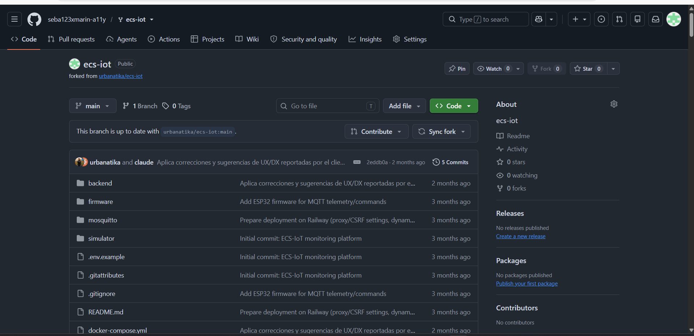
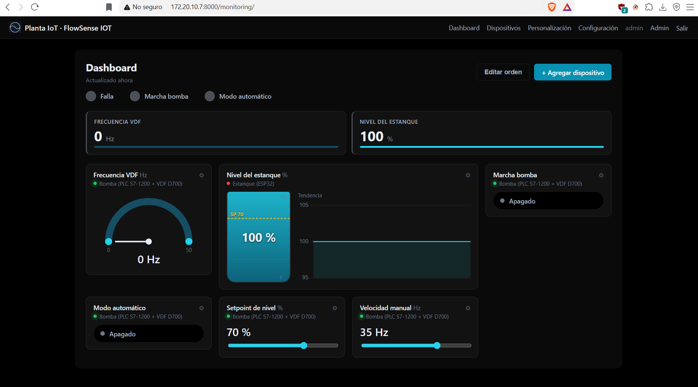
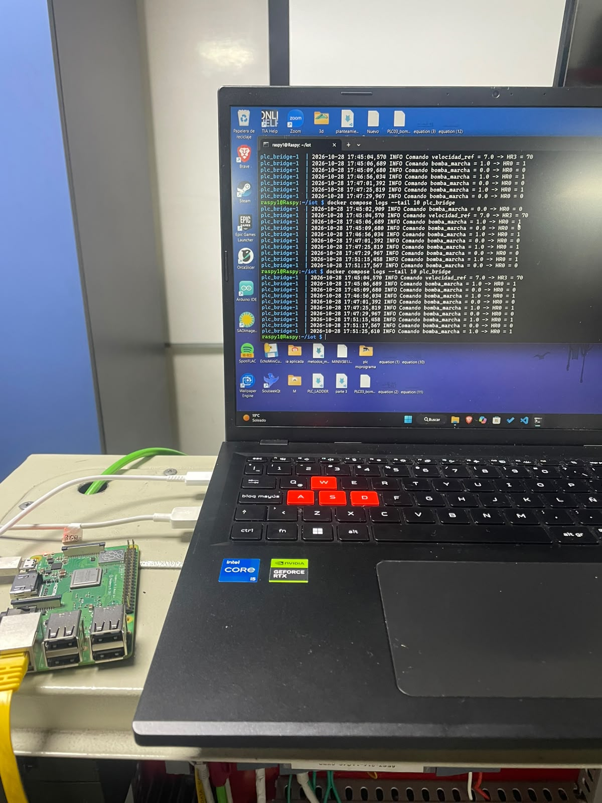

# Estanque IOT
Repositorio creado para la tarea de IoT donde se realizó una plataforma IoT en Django para monitorear y controlar en tiempo real una planta de flujo conectada a un PLC Siemens, junto con un ESP32 y una Raspberry Pi vía MQTT.

Integrantes:

DANIEL ALARCÓN ARAYA

VICTORIA CALDERON

BARTOLOMÉ COZ CUEVAS

SEBASTIÁN MARÍN CASTRO

##1. Repositorio clonado en cuenta personal

##2. Dashoard acorde al proyecto a trabajar con logos y colores propios
.

##3. Comunicación con sensores IoT en tiempo real
.
